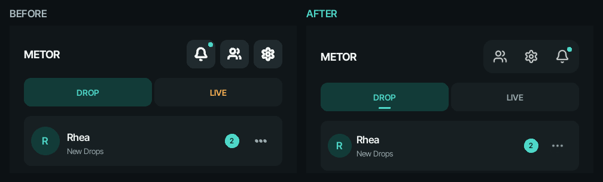

# Embedded UI release review — 2026-10-14

This is the test report for the audit and repairs of `embeddedui`, starting at
`87724a1cdcd46a6099485061c9ea4c2e2e230faa`. The target is **Desktop and Simulator**
on the documented Linux/Windows platforms. Physical embedded hardware is deferred
by the owner. This dated record is evidence; the reusable checklist and product
contracts remain in [AUDIT.md](../governance/AUDIT.md),
[ARCHITECTURE.md](../ARCHITECTURE.md), [FRONTENDS.md](../contracts/FRONTENDS.md)
and [GUI.md](../contracts/GUI.md).

**Disposition:** the implemented review candidate is ready for native desktop
acceptance after its required CI passes. Final release approval remains open for
real public-Tor messaging, physical audio and actual OS lock/suspend evidence.
Automated or simulated success does not establish those results. The owner has
requested that a local agent complete them using the
[self-contained handoff prompt](./2026-10-14-embeddedui-handoff.md).

[PR #11](https://github.com/DerWahreMirakulix/metor/pull/11) records the final
candidate SHA, CI run, complete matrix results and merge into `embeddedui`.
That merge is gated on all required jobs succeeding. A local agent must record
the actual pulled HEAD and verify this evidence before continuing; this report
does not predeclare a still-running CI result. The final documentation-only
handoff commit follows source/test anchor
`f9ba1ae64c749f90b70582f105ae234bc9e2bc51` and receives the same full CI gates.
No `main` merge, application version bump, tag or release publication is part of
this handoff. The application remains `0.2.0`; compatibility generations are
unchanged.

## Architecture assessment

Metor implements the intended messaging-framework boundary. SDK, Base, Terminal
and GUI own disjoint namespace files. The daemon owns authorization, Tor,
durable delivery and cryptographic lifecycle; frontends retain presentation and
interaction state. Device ports cover local observation and control without
granting Core permission. The reference adapter and simulator exercise the same
public contracts used by platform integration.

The source tree groups state owners and cohesive subsystems. This is a layered
domain-oriented implementation, not a claim that every directory is a pure DDD
bounded context. The public facades, dependency checker, generated DTO schema
and installed consumer checks make its boundaries reviewable. The architecture
guide now includes a repository ownership map. No broad directory relocation
was needed to correct the release findings.

The Python SDK is independently installable. Another language can implement
the documented NDJSON protocol without importing Python runtime internals.
Portability depends on the exact framing, authentication derivation,
correlation, version and reconnect contracts; these are now explicit in the
generated API guide. An IPC generation handshake does not negotiate individual
additive fields with an older implementation.

## Corrections included in this review

| Area                   | Problem and resulting behavior                                                                                                                                                                                                                                                                                                                          |
| ---------------------- | ------------------------------------------------------------------------------------------------------------------------------------------------------------------------------------------------------------------------------------------------------------------------------------------------------------------------------------------------------- |
| Offline execution      | The short-lived local executor used a loopback TCP listener. Its connection is changed to a private non-inheritable socket pair, preventing unrelated local clients from entering that operation's unlocked runtime. Its gate remains held until sensitive storage cleanup succeeds.                                                                    |
| Profile lifecycle      | Catalog mutations, startup, live instances and migration use stable external gates in a defined order. Managed processes retain instance ownership from initialization through cleanup. Offline operations recheck eligibility while holding the same exclusion, and recovery cannot discard an in-progress prepared migration.                         |
| Authentication         | Challenge and proof handling is tightened; portable documentation specifies domain-separated inputs, Argon parameters, encodings and one-use challenge behavior. The architecture reference is corrected to IPC generation 4.                                                                                                                           |
| Device privacy         | Temporary Power/purge covers cannot suppress idle or native-lock restriction. Lost focus, suspend and input loss cancel held destructive controls; stale device state cannot reopen a replaced profile.                                                                                                                                                 |
| Notification exports   | File-sink writes enforce private regular-file ownership and reject link/device/FIFO targets. POSIX opening cannot block on an unread FIFO. Canonical docs explicitly identify plaintext metadata exports and direct, non-Tor webhook networking.                                                                                                        |
| Contact labels         | Core rejects empty, control-bearing, surrogate or multiline new aliases while preserving Unicode, spaces and joined emoji. Existing malformed labels remain recoverable by lookup, rename or removal; UI output escaping remains independently enforced.                                                                                                |
| GUI interaction        | Native acceptance exercises readable compact controls, profile/security forms, keyboard focus and call navigation. Simulator configuration applies real scale/rotation and prevents undeclared desktop-audio fallback.                                                                                                                                  |
| Terminal               | Untrusted output is escaped at presentation boundaries. Aliases refresh consistently and slash commands accept quoted labels with spaces. Unicode grapheme/cell editing, bounded draft/history storage, cursor-centered multiline viewports, Windows surrogate decoding and height/width resize handling replace inconsistent character-count geometry. |
| CLI outcomes           | Rejected arguments, cancelled or invalid migration credentials, transport/authentication failures and incomplete offline teardown produce nonzero status. Unconfirmed execution is reported as an unknown outcome without leaking exception details. Human-readable CLI output remains distinct from the typed SDK/IPC integration contract.            |
| Installation           | README instructions now create and select an environment, explain first-profile setup, distinguish GUI autostart from independent daemon lifetime, and accurately describe Windows wheels and unpublished package-index targets.                                                                                                                        |
| Distribution integrity | Every distribution includes the canonical GPL license text; installed-artifact validation checks the actual wheel bytes. Terminal dependency closure remains separate from Base and SDK.                                                                                                                                                                |
| Dependencies           | Identified vulnerable pins are updated to `pip==26.2.1`, `setuptools==83.0.0` and `urllib3==2.8.0`; the final strict advisory audit covers all 39 pinned Linux/Windows third-party distributions with none skipped.                                                                                                                                     |
| Build cleanup          | Packaging removes only its own generated directories, preserving `build/test-report.txt`, audit evidence and earlier release variants. Destinations inside setuptools-owned directories fail before mutation.                                                                                                                                           |
| Release validation     | CI and release use one native GUI acceptance action, including compact/wide Core-backed windows, rendering, simulator configuration, stream pressure and an isolated native AT-SPI privacy gate. Redundant shell installer smoke blocks are removed; the checked native installer validator remains mandatory on both OS jobs.                          |
| Test strategy          | Behavioral regression, source-boundary and installed/native gates have distinct purposes. Contributor guidance rejects private-implementation mirrors as substitutes for observable behavior and keeps duplicate removal conditional on retained coverage.                                                                                              |

## Additional security and frontend repairs

- **Protected files and migrations:** Windows PIN credentials and profile keys
  share one owner-only ACL policy. Migration staging validates private ownership,
  bounded regular files and source identity, rejects links/special files, and
  uses exclusive temporary files. POSIX PIN reads open with nonblocking,
  no-follow descriptors and validate the actual descriptor before reading;
  replacing a candidate with a FIFO cannot hang authentication.
- **IPC and SDK failures:** malformed proof text, non-object JSON, invalid
  endpoints and non-finite limits fail explicitly. Connection budgets include
  DROP/CALL paths. Secret DTO fields are excluded from representations. Invalid
  or unknown SDK events terminate the connection and wake pending requests;
  failed initialization releases its lease.
- **GUI privacy after monitor failure:** loss of the native security observer
  permanently closes that GUI session. Unlock, reconnect, profile activation or
  a stale callback cannot restore private content. Accepted purge may expose
  only sanitized progress. The final cover offers Close and exits with failure;
  independent daemon clients remain usable.
- **GUI scrolling and completion:** bounded scrolling keeps footer controls
  reachable at low frame rates. Outgoing optimistic message rows do not count
  as confirmed Core completion in native acceptance. Real scale/rotation,
  control readability, accessible names, LIVE connecting state and DROP opening
  are exercised through the native event loop.
- **CLI encoding:** redirected stdout/stderr use UTF-8 while normal terminal and
  absent-windowed streams retain their appropriate behavior. Piped credentials
  use strict bounded UTF-8. Windows interactive prompting retains the TTY path.
- **Native Windows evidence:** the fixture owns a visible console, follows the
  actual launcher/interpreter chain, and checks that both GUI launchers preserve
  the original console without creating an extra one. Windowed startup without
  standard streams, native error handling, autostart cancellation, PIN security
  and Tor-child console suppression are covered. Hosted validation explicitly
  selects the pinned ANGLE backend; the product's default backend is unchanged.

The security review covered authentication and replay, framing and resource
bounds, credential/PMK lifecycle, storage permissions and replacement races,
profile exclusion and migration recovery, process ownership, notification export
boundaries, untrusted presentation and privacy revocation. Corrections have
behavioral regressions at the relevant boundaries. This is a source and runtime
review with the recorded evidence, not a formal cryptographic proof or a claim
that undiscovered vulnerabilities cannot exist.

## Verification evidence

The table distinguishes reproducible automated coverage from physical acceptance.
Final CI status and exact per-platform totals belong to PR #11's immutable run;
previous successful jobs must not be substituted for a failed final candidate.

| Gate                                  | Recorded result and scope                                                                                                                                                                                                                                                                    |
| ------------------------------------- | -------------------------------------------------------------------------------------------------------------------------------------------------------------------------------------------------------------------------------------------------------------------------------------------- |
| Static analysis                       | Ruff and formatting pass over 703 Python files; Mypy passes over 529 files for Linux/Python 3.11 and Windows/Python 3.13. The focused GUI Basedpyright gate passes all four platform/version targets.                                                                                        |
| Repository contracts                  | Import boundaries, generated-reference reproducibility, version/compatibility checks, Markdown formatting and local links pass. Generated documents are produced from their owners.                                                                                                          |
| Full runtime suite                    | Required matrix: Linux and Windows x86-64, CPython 3.11 and 3.13, each discovering 1,452 tests. Skips are explicit capability decisions, not passes: the preceding completed runs recorded 14 Linux and 31 Windows skips. Consult the final run for actual totals and failures.              |
| Packages and installers               | Fresh CPython 3.11 offline bundles, all four independently owned packages, isolated installed consumers, SDK typing, dynamic frontend IPC, uninstall/reinstall isolation and all four actual ZIP installers pass on both native CI platforms at the source/test anchor.                      |
| Linux native GUI                      | Compact/wide real Core-backed interaction, keyboard/mouse dispatch, low-frame-rate scrolling, scale/reflow/readability, simulator configuration, stream pressure and permanent monitor-failure cover pass. Native AT-SPI privacy checks pass from a separate process.                        |
| Windows native GUI                    | Both installed launchers, console preservation, no-stream error dialog, encrypted autostart cancellation, PIN and Tor-child launch checks pass. These are native CI desktop checks, not physical audio or OS-state transitions.                                                              |
| Targeted security and CLI regressions | Six POSIX PIN special-file/replacement cases, 12 actual CLI process cases with forced cp1252, and 12 prompt/output/failure cases pass.                                                                                                                                                       |
| Writer/cancellation regressions       | 53 related Voice tests and 12 focused transport cases pass. Deliberate slow encrypted staging reproduces the former fixture failure; explicit release fixes ordering. Injected extra coalesced bytes are detected; early-failure cleanup releases blocked workers.                           |
| Dependency advisories                 | Strict audit of all 39 pinned Linux/Windows third-party Python distributions reports zero known vulnerabilities and zero skipped distributions; all three resolved npm tooling packages also report zero. This is the advisory database result on the review date, not a security guarantee. |
| Public Tor peer roundtrip             | **OPEN:** no public-Tor relay connectivity in this cloud environment. Loopback routing and bootstrap-only checks are insufficient.                                                                                                                                                           |
| Physical audio and OS transitions     | **OPEN:** real microphone/playback/call audio, actual screen lock and suspend/resume need named-host evidence.                                                                                                                                                                               |

### Native artifact at the source/test anchor

[Run 38629245682](https://github.com/DerWahreMirakulix/metor/actions/runs/38629245682)
checks `f9ba1ae64c749f90b70582f105ae234bc9e2bc51`. Its Linux installed/native job
`116076301823`, Windows installed/native job `116076301488`, and static job
`116076301100` succeeded. The Linux artifact ID is `11925147798`, with archive
SHA-256 `2e7cf8933d628e78df9db09b5e59e16a4cea9e36cc7a1061e14cd3c121f4a260`.
It contains 48 PNGs and structured acceptance results:

- Compact 360 × 640 at font scale 1.5: 139 entries, including 137 successful
  Boolean checks and two geometry records; 378 XTest events.
- Desktop 1180 × 760 at font scale 1.5: 146 entries, including 144 successful
  Boolean checks and two geometry records; 352 XTest events.
- Both Core-backed scenarios retain 20 captures each and confirm GUI detach,
  an independently usable client and cleanup of their temporary Core runtime.

These runs use real GUI/SDK/Core IPC, SQLCipher and signed peer framing.
Loopback replaces Tor/SOCKS, and lifecycle events are supplied by controlled
fixtures. Neither is counted as actual Tor-network or OS-provider acceptance.
Artifact retention is finite; archive the relevant evidence with the final
release record if it must outlive GitHub Actions retention. Final handoff CI
regenerates native artifacts; PR #11 identifies that final run as well.

### Why the test corrections improve evidence

The native send fixture previously advanced when an optimistic row appeared,
before its pending Core request completed. A controlled 3.2-second real reply
reproduced the failure. Waiting for the visible row **and** no matching pending
request passes at both window sizes without extending production deadlines.

A Voice cancellation fixture previously released a writer barrier after two
seconds even if encrypted staging had not finished. On a slower Windows runner,
voice frames could pass before the cancellation being tested. The replacement
barrier is explicitly released by test cleanup; real socket and observation
deadlines remain bounded. The reader is retained so bytes already buffered after
the expected frame cannot disappear from the assertion. Negative controls show
both the former false failure and the former false pass. Cleanup failure tests
confirm the correction cannot strand the fixture's workers.

These are concurrency and stream-boundary checks with observable failure modes.
The test policy now distinguishes narrow state tests, process/IPC regressions,
native interaction, package ownership and physical acceptance. Redundant shell
installer checks were removed only where the checked native validator preserves
failure propagation; a coverage percentage is not used as a quality claim.

## Native acceptance still required

The [handoff prompt](./2026-10-14-embeddedui-handoff.md) is intended to be given
in full to the local agent after pulling `embeddedui`. It covers:

1. Actual public-Tor DROP and LIVE messages across GUI, Terminal and CLI, with
   received content and independent frontend/daemon lifetime evidence.
2. Real Voice capture, explicit preview/send, receipt/playback in both directions,
   device failure recovery, and accepted telephone-call audio/mute/hangup.
3. Actual OS screen lock and suspend/resume: protected private content, stopped
   Voice recording/playback, continued accepted calls on screen lock, and ended
   real-time audio after suspend. Simulated events do not close this item.
4. Native GUI screen/control review, resizing, text scale, focus/navigation,
   menus, destructive holds, and simulator scale/rotation/input behavior.
5. Fixes and suitable regressions for any defect, followed by final-commit CI and
   a result table with PASS/FAIL/BLOCKED, host details and concrete observations.

Linux desktop and simulator require SDL/OpenGL, system D-Bus and a registered
logind login resolvable through `GetSessionByPID`. An SSH shell, WSL or an Xvfb
display alone does not establish that production environment. Do not disable the
security observer to obtain a pass. Native Windows mixed-DPI and a user's actual
accessibility tools should be checked on the available desktop; the AT-SPI and
UIA fixtures do not certify every screen reader or display configuration.

Only the tested host can receive a physical acceptance claim. A Linux-only local
run cannot establish Windows audio/OS behavior, or vice versa. Physical embedded
hardware, other operating systems/architectures and acoustic echo cancellation
are not established by this review. Remaining failures or unavailable required
capabilities must stay explicit release blockers, with no blanket "release ready"
claim.

After native acceptance, follow [RELEASING.md](../RELEASING.md). Its release
workflow must validate the actual proposed version and native archives; ordinary
PR CI is not a substitute. A release dry run and publication were not executed
by this audit. Final merge into `main` and publication are separate owner actions.

## Native follow-up on 2026-11-03

The Windows checkout contained merge `b79907a9b73876cb2cb06e14c159874a8dbc1e01`.
Its tree matched PR #11 head `3609f6d7ce72bb3b9caec96670d7500407c2dcfb`.
All eight jobs passed on that PR head, including the
[required acceptance job](https://github.com/DerWahreMirakulix/metor/actions/runs/38632103796/job/116098396381).
The following tests used disposable profiles and a separate candidate branch.

### Repairs reproduced on the desktop

- **Tor profile directories.** With a data parent containing ` #1`, Tor
  0.4.9.5 truncated both directory directives at the comment marker. On this
  Windows system, passing UTF-8 bytes for an accented directory also created a
  different directory under code page 1252. Core now quotes each filesystem
  path as a single torrc value, escapes special bytes and rejects a Windows
  path that cannot round-trip through the system code page. With the fix, an
  actual network-disabled Tor process created its data and service directories
  under the supplied accented names, including the hashes. The service hostname
  appeared at the expected location. Both launcher paths have regression tests.
- **GUI clipboard privacy.** On Kivy 2.3.1, Ctrl+X exported a selected draft
  and removed it from the field. Cutting a password exported its mask and
  removed the password. Selection could also export draft text through the
  primary-selection callback. The field now intercepts both Kivy paths. The
  native regression drives Ctrl+C and Ctrl+X, checks text retention and ordinary
  deletion, and records clipboard calls using memory-only providers. A separate
  disposable Linux X11 display verified the behavior with the real Xclip
  provider. Before the repair, selecting and cutting a draft replaced both
  PRIMARY and CLIPBOARD. With the repair, both retained their sentinel values
  and the selected fields retained their contents.
- **Authentication prompts.** Starting a plaintext profile showed “Open profile”
  and “Profile password” while asking the user to choose a new runtime-only
  session password. The native Windows window and its accessibility tree now
  show “Start local service” and “New session password” for that action. Cold
  profile unlock and proof for an already running service retain their own
  prompts. The change is in commit `b3e6a266259093222cf8ce85498e949e02983924`.
- **Rotated simulator geometry.** Starting at a small window size, Windows SDL
  enlarged the drawable when Metor set its minimum height. Kivy still reported
  the old system dimensions when Metor then computed the target. A 1600 × 960
  configuration rotated 90° at scale 2 produced a 960 × 1328 client. Computing
  the target before setting the minimum restored the 960 × 1648 client,
  including its 48-pixel status banner. The regression enlarges a real SDL
  window from 800 × 600 and checks the shell, keyboard and audio capabilities.
- **Windows daemon ownership.** In a standard CPython virtual environment,
  launching an encrypted profile started a redirector and a second interpreter.
  The host compared the redirector's PID with the daemon's published PID,
  incorrectly reported that it had borrowed the daemon, and discarded the
  one-use startup credential. A 1,455-case run exposed three assertion failures
  and three errors across four lifetime tests. The Windows launcher now starts
  the interpreter directly with CPython's virtual-environment selection, keeps
  isolated mode and retains the strict PID check. Manual-launch tests identify
  only the matching interpreter child when a redirector is involved. All
  13 targeted lifetime tests passed in the same virtual environment.

### Native evidence

**W** is the local Windows 11 Home x86-64 desktop (build 26300.9818),
CPython 3.11.13 and Tor 0.4.9.5. **L** is Ubuntu 22.04.2 x86-64 under WSL2,
CPython 3.11.15 and Tor 0.4.9.5. WSLg advertised a display, but logind
could not resolve the shell's login session. Production GUI observations below
are attributed to Windows. **C** is source commit
`b39a370029485a5e84ce9d9967d6164a68628566`. The original WSL checkout was
at `9de90d0372cad53d2122bd4013bb563ff2793030`. Tests used isolated candidate
copies, separate from the user's profile directories.

**P** is the credential-prompt revision `b3e6a266259093222cf8ce85498e949e02983924`.
**S** is the simulator repair `cb3a9f43e93dba5e6ff9000c9ec0eb30460596b5`.
**F** is `0852529ab9c88aa733b76c762f9a95f1829f8894`. Its two commits
after S change only the three standalone native fixtures.
**D** is the Windows daemon repair `432969e8db14ac2f6ebc72c38f6da6d01b3d63e1`.

| Check                                         | PASS/FAIL/BLOCKED | Observed evidence                                                                                                                                                                                                                                                                                                                                                                                                                                                                   | Host                          | Commit                |
| --------------------------------------------- | ----------------- | ----------------------------------------------------------------------------------------------------------------------------------------------------------------------------------------------------------------------------------------------------------------------------------------------------------------------------------------------------------------------------------------------------------------------------------------------------------------------------------- | ----------------------------- | --------------------- |
| Public-Tor DROP                               | PASS              | Two encrypted peers received `dropB-4d923c` (CLI to Terminal) and `dropA-4d923c` (Terminal to Terminal). After reopen, each received DROP appeared exactly once in the relevant CLI history.                                                                                                                                                                                                                                                                                        | L                             | C                     |
| Public-Tor LIVE text                          | PASS              | Alice explicitly accepted Bob's invitation. Both Terminals showed the connected state and the other peer's distinct LIVE text. Bob received Alice's second line.                                                                                                                                                                                                                                                                                                                    | L                             | C                     |
| Windows ↔ WSL public-Tor DROP and LIVE        | PASS              | In run `f07a93`, each native CLI sent a DROP that appeared in the opposite Terminal. Windows accepted WSL's invitation and both Terminals received the other peer's LIVE text. Windows history contained each DROP once. Both encrypted profiles used parents containing spaces, a hash and an accented character. All acceptance daemon and Tor processes exited.                                                                                                                  | W ↔ L                         | W: P, L: C            |
| CLI and Terminal interoperability             | PASS              | A second Alice Terminal authenticated independently. The CLI observed the quoted alias `Böb Chat`. An incoming LIVE message and a PTY resize preserved Alice's Unicode draft before send.                                                                                                                                                                                                                                                                                           | L                             | C                     |
| Independent Terminal lifetime                 | PASS              | Alice's second Terminal still queried contacts after the first exited. All acceptance Terminals exited with status 0. Their scoped daemon and Tor workers exited after the last participant.                                                                                                                                                                                                                                                                                        | L                             | C                     |
| Tor path isolation                            | PASS              | Real Tor wrote its data and onion-service files under the requested accented directories containing a hash on both hosts with networking disabled.                                                                                                                                                                                                                                                                                                                                  | W, L                          | C                     |
| Private field clipboard                       | PASS              | Kivy's native Ctrl+C/X path retained draft and password contents, and the primary-selection callback made no export to either memory-backed provider. The ordinary deletion check passed.                                                                                                                                                                                                                                                                                           | W, L (offscreen widget check) | C                     |
| Windows installed artifacts and launchers     | PASS              | Built four fresh 0.2.0 offline bundles per revision. All four ZIPs installed, and the installed GUI checks passed with SDL2/ANGLE, including existing-console preservation and orderly autostart cancellation. On S the installed consumer also passed public-Tor startup and IPC with a disposable profile.                                                                                                                                                                        | W                             | C, S                  |
| WSL CLI → Windows GUI DROP                    | PASS              | The native GUI rendered the received body `WSL-CLI-to-Windows-GUI-b5273b` under the sending peer and showed Read. The isolated host supplied a one-use synthetic credential through the public frontend bootstrap contract; the GUI performed the production SDK challenge proof.                                                                                                                                                                                                   | W ↔ L                         | S                     |
| Windows GUI → WSL Terminal DROP               | PASS              | A native pointer click on Send produced a Pending row for `Windows-GUI-DROP-to-WSL-f9e2d9`. The WSL peer independently read that body through its Terminal inbox. Its reciprocal CLI DROP also appeared in the Windows GUI.                                                                                                                                                                                                                                                         | W ↔ L                         | W: F, L: S            |
| Windows GUI ↔ WSL Terminal public-Tor LIVE    | PASS              | The GUI explicitly accepted the invitation and rendered `WSL-Terminal-LIVE-to-Windows-GUI-c2edcb`. A native click on Send submitted `Windows-GUI-LIVE-to-WSL-c2edcb`, which appeared in the WSL Terminal. The GUI detached while its local Terminal remained attached and another CLI authenticated and read history.                                                                                                                                                               | W ↔ L                         | S                     |
| GUI detach and independent reattach           | PASS              | After the first GUI closed, the attached Windows Terminal remained usable. A separately authenticated CLI counted each of the two DROPs once. A fresh GUI process authenticated via a new one-use host credential and displayed the incoming DROP as Read and the outgoing DROP as Delivered. All acceptance clients and their daemon and Tor children exited.                                                                                                                      | W ↔ L                         | W: F, L: S            |
| Desktop entry and authentication UI           | PASS              | Inspected the 1180 × 760 first-run window and its UI Automation tree for the named profile, password, confirmation, Create and Back controls. Verified the changed masked field, explanation, Start local service and Cancel on the plaintext daemon startup screen. Native SDL2/GLEW with NVIDIA OpenGL 4.6 at 96 DPI.                                                                                                                                                             | W                             | C, P                  |
| Simulator configuration and touch keyboard    | PASS              | The repository example inherited disallowed write permissions. An owner-private copy with identical bytes mounted its 480 × 800 usable layout. The local touch keyboard entered a visible and accessible character. The private 90° scale-2 variant mounted a 960 × 1600 usable area plus the 48-pixel banner after repair. The active 1920 × 1032 work area could not display the entire scale-2 window simultaneously.                                                            | W                             | C, S                  |
| Native layout, input, focus and accessibility | PASS              | The conversation fixture exercised 360 × 640, widths 959 and 960, and 1180 × 760 at 1.5× font scale. It checked Enter/Shift+Enter, pending sends, draft retention and a real resize with a 20-endpoint synthetic picker open. A physical 96 → 144 → 96 DPI monitor move preserved the logical control minimum. Separate simulator inspection covered New Drop, empty contacts, camera-unavailable recovery, manual contact entry, wide two-pane navigation and empty notifications. | W                             | S product, F fixtures |
| Linux native simulator regression             | PASS              | A 1280 × 1600 Xvfb display exercised the SDL2/X11 resize sequence. The fixture waits within its original 15-second deadline for the requested 840 × 1488 drawable and 840 × 1440 shell and rechecks geometry with the keyboard open. A permanent 836-pixel-width mismatch failed at the deadline.                                                                                                                                                                                   | L                             | S product, F fixture  |
| Linux installed artifacts and launchers       | PASS              | All four fresh CPython 3.11 x86-64 ZIP installers passed. Isolated consumers passed the installed native GUI smoke check on a private X11 display, independent frontend removal and SDK reimport.                                                                                                                                                                                                                                                                                   | L                             | F                     |
| Windows installed daemon identity             | PASS              | A fresh installed frontend reported ownership of the exact PID published by its daemon. The credential could be claimed once, the SDK challenge succeeded, and a second attachment acquired neither startup ownership nor its secret. The last lease released the daemon. Locked startup and public-Tor startup passed the installed PID check.                                                                                                                                     | W                             | D                     |
| Linux full unittest inventory                 | PASS              | 1,455 cases accounted for, with 1,441 passes and 14 skips. No failures or errors.                                                                                                                                                                                                                                                                                                                                                                                                   | L                             | S                     |
| Final installed consumers                     | PASS              | Both platforms passed the isolated SDK, Base, Terminal and GUI checks with freshly rebuilt bundles, installed native GUI smoke, and the stricter managed daemon PID check.                                                                                                                                                                                                                                                                                                          | W, L                          | D                     |
| Physical DROP and LIVE Voice, Alice → Bob     | BLOCKED           | No spoken sample or human observation of intelligible playback.                                                                                                                                                                                                                                                                                                                                                                                                                     | W                             | C                     |
| Physical DROP and LIVE Voice, Bob → Alice     | BLOCKED           | No reverse-direction capture, preview, discard, or playback observation.                                                                                                                                                                                                                                                                                                                                                                                                            | W                             | C                     |
| Audio endpoint recovery and two-way calls     | BLOCKED           | PortAudio 19.7.0 enumerated headset, USB, and Realtek devices. Endpoint disconnect, audible calls, Mute, and Hang up were deferred.                                                                                                                                                                                                                                                                                                                                                 | W                             | C                     |
| Actual OS lock during recording               | BLOCKED           | Physical lock and recording were deferred.                                                                                                                                                                                                                                                                                                                                                                                                                                          | W                             | C                     |
| Actual OS lock during playback                | BLOCKED           | Physical lock and playback were deferred.                                                                                                                                                                                                                                                                                                                                                                                                                                           | W                             | C                     |
| Accepted call under OS lock                   | BLOCKED           | No live call was observed across a physical screen lock.                                                                                                                                                                                                                                                                                                                                                                                                                            | W                             | C                     |
| Actual suspend/resume                         | BLOCKED           | System sleep and post-resume call/media observations were deferred.                                                                                                                                                                                                                                                                                                                                                                                                                 | W                             | C                     |

The owner deferred the physical checks. Entering credentials by hand, destructive
profile actions, physical touch hardware and comprehensive assistive-technology
coverage were outside the observed paths. The public-Tor GUI runs used the
documented host bootstrap credential for a disposable encrypted profile.
The ordinary installed launcher was independently exercised through its masked
prompt and cancellation path.

The public-Tor and native renderer checks above establish software behavior
on these hosts. Release acceptance remains open for physical Voice, calls, and
OS lock/suspend. The full hosted matrix for a direct push can be identified by
its exact head SHA in the
[manually dispatched CI runs for embeddedui](https://github.com/DerWahreMirakulix/metor/actions/workflows/ci.yml?query=branch%3Aembeddedui+event%3Aworkflow_dispatch).

## Visual review on 2026-11-03

Compared the native Windows renderer at `0517d7c` with the GUI built from
[`f307cd1`](https://github.com/DerWahreMirakulix/metor/commit/f307cd130ab0d5b7682fdcbd13dd09353458f1f4).
The two images below are crops of the same synthetic conversation list at
480 × 800 logical units and 100% text. Each toolbar action retains a 48 × 48
target; the notification indicator now sits eight units inside the top and
right of the bell's target.

- **Navigation and chat:** DROP and LIVE now indicate the active mode with an
  underline as well as color. Short messages use less vertical space while
  keeping a full-size action target. The composer has one focus outline;
  playback and duration sit together in voice review.
- **Forms and secondary screens:** single-page contact lists keep Add visible
  without showing page arrows. Settings put long values below their labels
  when space is tight. In the narrow profile form at 150% text, the masked
  confirmation field and submit action stayed reachable with the touch
  keyboard open. The PIN screen kept Unlock on one line.
- **Field contrast:** against the default field fill, the palette's relative
  luminance ratios were 13.58:1 for entered text, 6.04:1 for placeholder
  text, 3.15:1 for the enabled outline and 8.29:1 for the focused outline.
- **Window coverage:** all 45 native capture scenarios passed on Windows
  (80 combinations of view, size and text scale). Comparisons used 360 × 640
  at 150% text, 480 × 800 at 100%, and 1180 × 760 at 100%. Live resizing at
  the 959/960 breakpoint preserved route, draft, focus and scroll position.
  A move from a 96 DPI monitor to a 144 DPI monitor and back passed.
- **Long content:** a 320-character alias previously made one compact list
  row more than 2,000 units high. List previews now end in an ellipsis when
  needed. In the tested compact conversation at 150% text, the full alias
  scrolled in three lines, the header occupied 231 units, and 265 remained
  for the timeline. Navigation, call and overflow controls stayed reachable.
- **Installed native behavior:** both Windows and Linux GUI installations
  matched the 253 GUI source and asset files. All 12 Linux GUI acceptance
  scenarios passed on X11, including Core-backed compact and wide journeys
  driven by XTest, AT-SPI privacy and actions, keyboard and modal focus,
  pointer scrolling, and bounded stream processing.
- **GUI regression suite:** all 490 GUI tests passed without skips on both
  Windows and Linux at the linked product revision. The separate Windows
  full-suite run during the review passed 1,419 of 1,455 tests with 36 skips.
- **Linux full-suite setup:** the first run during the review had 1,438 passes,
  14 platform skips and three failed daemon-ownership assertions. The parent
  imported the source checkout from `PYTHONPATH`, while children launched
  with `python -I` used a different editable installation. The PID check
  rejects a different installation root by design. With the parent and child
  using the same installed wheels, all 13 frontend-lifetime tests passed
  without skips. The three original failures also passed on an independent
  fresh build of the same commit. No ownership checks were relaxed.

These checks used synthetic UI content or disposable local Core profiles.
They did not retest live microphone or speaker audio, real calls across an OS
lock, physical touch hardware, or suspend/resume.
